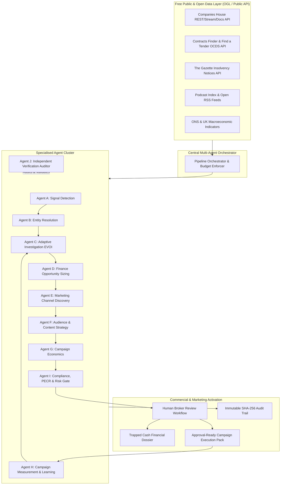

# Autonomous Engineering Programme: UK Working-Capital Intelligence & Marketing Activation

**Branch:** `marketing-focus`  
**Repository:** `https://github.com/markfromearth/uk-working-capital-intelligence.git`  
**Standard:** Evidence-driven, zero mandatory paid dependencies, multi-agent orchestration, verifiable commercial outcome learning.

---

## 1. Executive Assessment (Deliverable A)

### Current Product Maturity: Tier 2 (Advanced Prototype / Pre-Production Hybrid)
The existing platform provides deterministic statutory intelligence for UK commercial finance brokers. Key existing strengths include:
- Strict UK Company Registration Number (CRN) normalization (8-character alphanumeric, Scottish `SC`, Northern Irish `NI`, and LLP `OC`).
- Resilient Companies House API client with a 600 req/5min token bucket and cursor-resumed streaming ingestion.
- True iXBRL balance sheet parsing (`backend/app/services/ixbrl_parser.py`) and PyMuPDF vision extraction (`backend/app/services/pdf_vision_extractor.py`) for statutory accounts.
- Cryptographic SHA-256 audit log chains (`backend/app/services/audit.py`).
- Point-in-time bi-temporal feature store isolation and right-censored ML datasets.

### Critical Gaps Addressed by this Programme:
1. **Zero-Cost Data Expansion**: Eradicate simulated commercial credit bureau stubs (Creditsafe/Experian) and obsolete scraper stubs (Proxycurl). Replace with official, free open government data (OGL): Contracts Finder / Find a Tender (OCDS) and The Gazette Insolvency Notices.
2. **Integrated Marketing Intelligence Engine**: Bridge the gap between financial signal detection and commercial outreach. Introduce zero-cost discovery for UK business podcasts (Podcast Index, open RSS), trade publications, industry events, and trade associations.
3. **Full-Funnel Campaign Economics**: Replace arbitrary lead scores with transparent unit economics (Reach → Engagement → Qualified Opportunity → Facility Funded) with explicit 3-scenario uncertainty bounds.
4. **Decoupled Multi-Agent Architecture**: Move from monolithic script execution to 10 specialised, budget-bounded, typed agents with an independent verification auditor.
5. **Campaign Measurement & Empirical Learning**: Ingest post-campaign outcomes to empirically refine prior beliefs without target leakage or future lookahead bias.

---

## 2. Target Architecture (Deliverable B)



### Component Responsibilities:
- **Central Orchestrator**: Assigns bounded tasks, tracks runtime budgets (max £0.00 for external APIs in free mode), monitors circuit breakers, and enforces dependency gates.
- **Agent A (Signal Detection)**: Detects commercial events (MR04 charge satisfactions, procurement contract awards, director changes, Gazette notices).
- **Agent B (Entity Resolution)**: Normalizes CRNs, matches corporate entities, and prevents false-positive merges.
- **Agent C (Adaptive Investigation)**: Computes Expected Value of Information (EVOI) to decide if further querying is economically justified.
- **Agent D (Finance Opportunity)**: Sizes eligible debtors, unencumbered assets, and matches borrowing archetypes.
- **Agent E (Marketing Research)**: Catalogs verified podcasts, events, trade associations, and publications without fabricating audience figures.
- **Agent F (Audience Strategy)**: Formulates compliant, education-led B2B messaging aligned to corporate commercial needs.
- **Agent G (Campaign Economics)**: Calculates CAC, expected yield, and payback scenarios.
- **Agent H (Measurement & Learning)**: Binds UTM/campaign tracking IDs to actual broker conversions and updates empirical EVOI priors.
- **Agent I (Compliance & Risk)**: Enforces PECR B2B marketing rules, Corporate Subscriber validation, and right-to-erasure suppressions.
- **Agent J (Independent Verification)**: Checks test suites, schema validation, and audit chains independently.

---

## 3. Free-Service & Open-Source Feasibility Matrix (Deliverable E)

| Provider / Source | Endpoint / Access Method | Pricing Terms | Rate Limits | Permitted Use | Status |
| :--- | :--- | :--- | :--- | :--- | :--- |
| **Companies House REST** | `api.company-information.service.gov.uk` | Free (Official key) | 600 req / 5 min | Commercial (OGL v3.0) | **FREE-VERIFIED** |
| **Companies House Streaming** | `stream.companieshouse.gov.uk` | Free (Official key) | Persistent HTTP Stream | Commercial (OGL v3.0) | **FREE-VERIFIED** |
| **Contracts Finder OCDS** | `www.contractsfinder.service.gov.uk` | Free (No key required) | ~60 req / min | Commercial (OGL v3.0) | **FREE-VERIFIED** |
| **Find a Tender (FTS)** | `www.find-tender.service.gov.uk` | Free (Public API) | Standard public rate | Commercial (OGL v3.0) | **FREE-VERIFIED** |
| **The Gazette Notices** | `www.thegazette.co.uk` | Free (Linked data / RDF) | Polite crawler limits | Commercial (Crown Copyright) | **FREE-VERIFIED** |
| **Podcast Index API** | `api.podcastindex.org` | Free (Developer key) | Free public tier | Commercial (CC-BY-SA 4.0) | **FREE-VERIFIED** |
| **Apple iTunes Search** | `itunes.apple.com/search` | Free (No key required) | ~20 req / min | Metadata lookup only | **FREE-WITH-CAVEATS** |
| **Local LLM (Ollama)** | Local engine (Llama 3.2 / Mistral) | 100% Free / Self-hosted | Unbounded local hardware | Open-weights licence | **FREE-VERIFIED** |
| **Creditsafe / Experian** | Commercial API | Paid subscription | Contractual | Paid only | **DISALLOWED (Mock/Deprecate)** |

---

## 4. Complete Implementation Prompt Sequence (Deliverable F)

### Prompt 01: FIX-BASELINE-TESTS-AND-CI
- **Phase:** Phase 0 & 1 (Engineering Foundations & Baseline)
- **Prerequisites:** Clean git checkout on `marketing-focus`.
- **Objective:** Eliminate existing test suite failures, ensure hermetic test execution, and guarantee a 100% passing test baseline across all 124 tests.
- **Files to Inspect:** `tests/test_e2e_full_audit.py`, `tests/test_entity_resolution.py`, `backend/app/services/accounts_fetcher.py`.
- **Files Permitted to Modify:** `backend/app/services/accounts_fetcher.py`, `tests/test_entity_resolution.py`, `tests/test_e2e_full_audit.py`.
- **Instructions:**
  1. Wrap `AccountsFetcher.download_document` in a safe exception handler (`httpx.RequestError`, `httpx.TimeoutException`) returning `(None, None)` on timeout or connection error rather than crashing the pipeline.
  2. In `tests/test_entity_resolution.py`, update `db_session` fixture to explicitly upsert `Apex Precision Engineering Ltd` on `08931201` so cross-test database state does not cause mismatch.
  3. Verify that `PYTHONPATH=. .venv/bin/pytest tests/` runs to completion with 0 failures.
- **Acceptance Criteria:** `pytest tests/` exits with code 0 and reports $\ge 124$ tests passed and 0 failures.

### Prompt 02: VERCEL-CONFIG-AND-ENV-HARDENING
- **Phase:** Phase 1 (Engineering Foundations)
- **Prerequisites:** Prompt 01 passed.
- **Objective:** Modernize `vercel.json` to eliminate the legacy `builds` configuration warning and enforce deterministic environment switching.
- **Files to Inspect:** `vercel.json`, `api/index.py`, `.env.example`, `backend/app/config.py`.
- **Files Permitted to Modify:** `vercel.json`, `backend/app/config.py`.
- **Instructions:**
  1. Replace legacy `builds` and `routes` in `vercel.json` with modern `rewrites`:
     ```json
     {
       "rewrites": [
         { "source": "/(.*)", "destination": "/api/index.py" }
       ]
     }
     ```
  2. Ensure `backend/app/config.py` validates `ENVIRONMENT` strictly (`development`, `staging`, `production`) and disables synthetic fixtures automatically when `ENVIRONMENT=production`.
- **Acceptance Criteria:** Vercel deployment parses without build-settings warnings; configuration tests pass.

### Prompt 03: PROCUREMENT-AND-GAZETTE-INGESTION
- **Phase:** Phase 2 & 3 (Canonical Evidence & Public Signals)
- **Prerequisites:** Prompt 02 passed.
- **Objective:** Ingest official free UK government signals from Contracts Finder / FTS OCDS APIs and The Gazette Insolvency Notices API.
- **Files to Inspect:** `backend/app/services/ingestion.py`, `backend/app/services/indicator_engine.py`, `backend/app/models/signal.py`.
- **Files Permitted to Modify:** `backend/app/providers/contracts_finder.py` (new), `backend/app/providers/the_gazette.py` (new), `backend/app/services/indicator_engine.py`, `tests/test_procurement_and_gazette.py` (new).
- **Instructions:**
  1. Build `ContractsFinderAdapter` fetching procurement notices via OCDS search endpoint. Map award supplier to CRN and emit `CONTRACT_AWARD_GROWTH` signal.
  2. Build `GazetteAdapter` fetching official insolvency notices (petitions, liquidators appointed) and emit `STATUTORY_INSOLVENCY_NOTICE` signal.
  3. Wire signals into `indicator_engine.py` with automatic knockout or risk weighting.
- **Acceptance Criteria:** All new tests in `tests/test_procurement_and_gazette.py` pass; signals carry primary source URLs.

### Prompt 04: FREE-TOOL-REGISTRY-EXPANSION
- **Phase:** Phase 4 (Adaptive Investigation)
- **Prerequisites:** Prompt 03 passed.
- **Objective:** Eliminate mandatory paid bureau stubs in `tool_registry.py` and replace with free statutory tools (Contracts Finder lookup, Gazette notice search, ONS SIC benchmark).
- **Files to Inspect:** `backend/app/services/tool_registry.py`, `backend/app/services/investigation_engine.py`.
- **Files Permitted to Modify:** `backend/app/services/tool_registry.py`, `tests/test_adaptive_investigation_and_ml.py`.
- **Instructions:**
  1. Register `contracts_finder_awards_lookup` (cost: £0.00).
  2. Register `the_gazette_insolvency_check` (cost: £0.00).
  3. Demote Creditsafe and Experian tools to `is_live_ready=False` when API keys are blank, with explicit `requires_paid_subscription=True` flags.
  4. Ensure EVOI calculation reflects £0.00 marginal query cost for open public APIs.
- **Acceptance Criteria:** EVOI prioritizes zero-cost public queries; paid tools are never executed in free mode.

### Prompt 05: DECOUPLED-MULTI-AGENT-ORCHESTRATOR
- **Phase:** Phase 5 (Multi-Agent Architecture)
- **Prerequisites:** Prompt 04 passed.
- **Objective:** Implement asynchronous typed contracts for Agents A through J with concurrency control and budget tracking.
- **Files to Inspect:** `backend/app/services/pipeline_orchestrator.py`, `backend/app/schemas/warden.py`.
- **Files Permitted to Modify:** `backend/app/agents/` (new directory), `backend/app/services/pipeline_orchestrator.py`, `tests/test_agent_orchestration.py` (new).
- **Instructions:**
  1. Create typed Pydantic task envelopes: `AgentTaskRequest` and `AgentTaskResult`.
  2. Decouple `SignalDetectionAgent`, `OpportunityAgent`, and `IndependentVerificationAgent`.
  3. Enforce deterministic timeout and retry limits per agent task.
- **Acceptance Criteria:** `test_agent_orchestration.py` proves agents execute in sequence with traceable decision outputs and zero cross-agent state leakage.

### Prompt 06: MARKETING-CHANNEL-DISCOVERY-ENGINE
- **Phase:** Phase 6 (Marketing Intelligence Data Layer)
- **Prerequisites:** Prompt 05 passed.
- **Objective:** Implement free B2B marketing channel discovery across UK podcasts, trade associations, industry conferences, and publications.
- **Files to Inspect:** `backend/app/services/audience_activation.py`.
- **Files Permitted to Modify:** `backend/app/services/marketing_discovery.py` (new), `backend/app/models/marketing.py` (new), `tests/test_marketing_discovery.py` (new).
- **Instructions:**
  1. Integrate Podcast Index API and open iTunes Search API to search B2B finance, logistics, construction, and manufacturing podcasts.
  2. Catalog UK trade associations by SIC division (e.g. Road Haulage Association for SIC 49, Make UK for SIC 25).
  3. Mark audience sizes as `UNOBSERVED` unless verified by published data; forbid simulated listener numbers.
- **Acceptance Criteria:** Discovery engine returns verified channel candidates with source references and zero fabricated statistics.

### Prompt 07: AUDIENCE-SEGMENTATION-AND-STRATEGY-GENERATOR
- **Phase:** Phase 7 (Marketing Strategy & Campaign Generation)
- **Prerequisites:** Prompt 06 passed.
- **Objective:** Generate differentiated, evidence-backed B2B marketing strategies based on company growth stage and financing needs.
- **Files to Inspect:** `backend/app/services/opportunity_assessment.py`, `backend/app/services/product_matcher.py`.
- **Files Permitted to Modify:** `backend/app/services/campaign_strategy.py` (new), `backend/app/schemas/marketing.py` (new), `tests/test_campaign_strategy.py` (new).
- **Instructions:**
  1. Formulate distinct strategies per segment:
     - Rapid Growth / Contract Win: Cash-flow acceleration briefs for MDs.
     - White Space / Unencumbered Ledger: Refinance comparison guides for Finance Directors.
     - Seasonal Working Capital: Working-capital benchmark calculators.
  2. Generate approval-ready campaign packs containing creative angles, placement rationale, and compliance guardrails.
- **Acceptance Criteria:** Output contains concrete test plans, success/failure criteria, and zero personal profiling.

### Prompt 08: CAMPAIGN-ECONOMICS-AND-TEST-PLANNING
- **Phase:** Phase 7 (Campaign Economics)
- **Prerequisites:** Prompt 07 passed.
- **Objective:** Implement full-funnel commercial unit economics modeling with explicit uncertainty bounds.
- **Files to Inspect:** `backend/app/services/quant_math.py`.
- **Files Permitted to Modify:** `backend/app/services/campaign_economics.py` (new), `tests/test_campaign_economics.py` (new).
- **Instructions:**
  1. Model funnel: Reach $\to$ Qualified Lead $\to$ Application $\to$ Funded Facility $\to$ Commission.
  2. Compute 3 scenarios: Conservative, Base, and Optimistic.
  3. Calculate break-even response rates and maximum test budget.
- **Acceptance Criteria:** Economics calculations explicitly isolate assumptions from verified historical conversions.

### Prompt 09: CAMPAIGN-OUTCOME-MEASUREMENT-AND-LEARNING
- **Phase:** Phase 8 (Measurement & Outcome Learning)
- **Prerequisites:** Prompt 08 passed.
- **Objective:** Connect campaign tracking codes to downstream commercial funding conversions and update model priors.
- **Files to Inspect:** `backend/app/services/outcome_learning.py`, `backend/app/ml/evoi_learning.py`.
- **Files Permitted to Modify:** `backend/app/services/outcome_learning.py`, `backend/app/models/marketing.py`, `tests/test_campaign_learning.py` (new).
- **Instructions:**
  1. Issue deterministic campaign tracking identifiers (`CMP-YYYYMM-XXXX`).
  2. Implement manual/CSV outcome ingestion: impressions, qualified enquiries, and funded deals.
  3. Update Bayesian EVOI priors using real campaign yield.
- **Acceptance Criteria:** Empirical conversion rates update cleanly; future data leakage is prevented via snapshot timestamps.

### Prompt 10: UNIFIED-MARKETING-AND-INTELLIGENCE-DASHBOARD
- **Phase:** Phase 9 (Product Integration & UI)
- **Prerequisites:** Prompt 09 passed.
- **Objective:** Expose marketing recommendations, channel discovery, and campaign briefs in the web interface alongside trapped cash dossiers.
- **Files to Inspect:** `frontend/dist/index.html`, `backend/app/api/v1/audiences.py`.
- **Files Permitted to Modify:** `backend/app/api/v1/marketing.py` (new), `frontend/dist/index.html`, `tests/test_marketing_api.py` (new).
- **Instructions:**
  1. Expose `GET /api/v1/marketing/channels` and `POST /api/v1/marketing/campaigns/plan`.
  2. Render Marketing Strategy tab in UI with channel candidates, economics calculator, and campaign brief export.
- **Acceptance Criteria:** End-to-end browser and API tests pass; UI renders responsive campaign briefs.

### Prompt 11: SECURITY-AUDIT-AND-ADVERSARIAL-VERIFICATION
- **Phase:** Phase 10 & 11 (Security, Privacy & Adversarial Hardening)
- **Prerequisites:** Prompt 10 passed.
- **Objective:** Hard-test PECR marketing permission guards, corporate subscriber validation, SSRF protections, and cryptographic audit chains.
- **Files to Inspect:** `backend/app/services/audit.py`, `backend/app/services/identity_resolution.py`.
- **Files Permitted to Modify:** `backend/app/services/identity_resolution.py`, `tests/test_marketing_compliance_adversarial.py` (new).
- **Instructions:**
  1. Add strict Corporate Subscriber verification: block marketing activation for sole traders or non-corporate entities without prior consent.
  2. Test SSRF protections on RSS feed parsers and external webhook endpoints.
  3. Validate cryptographic hash integrity across the full audit chain.
- **Acceptance Criteria:** All adversarial attack tests pass; zero unauthorized data activations.

### Prompt 12: OPERATIONAL-RUNBOOKS-AND-RELEASE-GATE
- **Phase:** Phase 12 (Release Certification & Operation)
- **Prerequisites:** Prompt 11 passed.
- **Objective:** Final end-to-end regression audit, Docker validation, operational runbooks, and release certification.
- **Files to Inspect:** `Dockerfile`, `docker-compose.yml`, `docs/deployment-runbook.md`.
- **Files Permitted to Modify:** `docs/deployment-runbook.md`, `README.md`.
- **Instructions:**
  1. Execute full regression suite with coverage.
  2. Validate zero-credential startup mode (100% functional on free public data).
  3. Produce signed release certificate.
- **Acceptance Criteria:** Full test suite passes; release decision marked PRODUCTION READY.

---

## 5. Release Decision Framework (Deliverables G & H)

```
[ NOT READY ]  --->  [ INTERNAL TESTING ]  --->  [ CONTROLLED PILOT ]  --->  [ PRODUCTION READY ]
```
- **NOT READY:** Any test failure in test suite, unhandled timeout on external HTTP calls, or paid provider requirements in default configuration.
- **INTERNAL TESTING:** 100% of unit and integration tests pass hermetically; free public adapters verified against recorded fixtures.
- **CONTROLLED PILOT:** Companies House live key configured; Contracts Finder OCDS pipeline running; human broker approval enforced on all campaign activations.
- **PRODUCTION READY:** All 12 prompts executed and verified; PECR compliance verified; audit hash chain intact; zero unverified claims.
